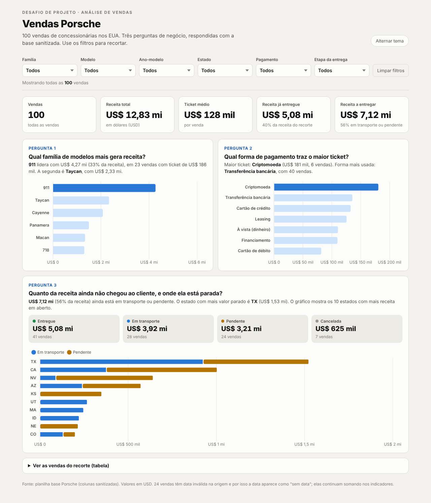
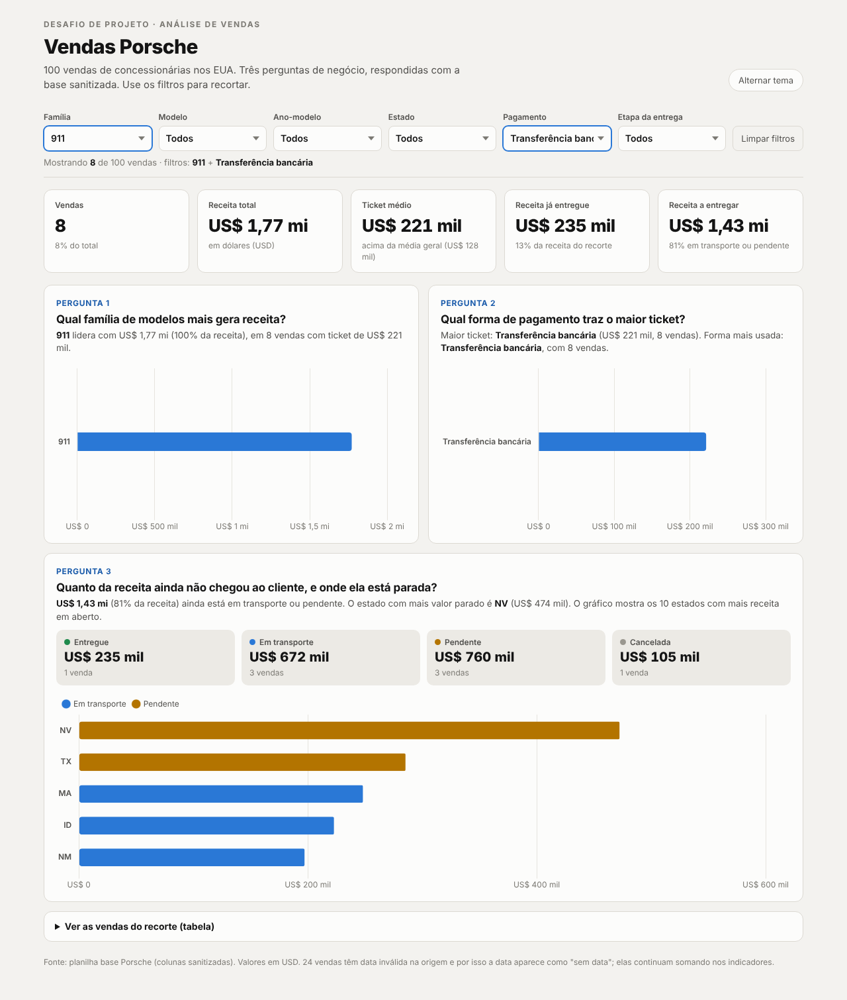
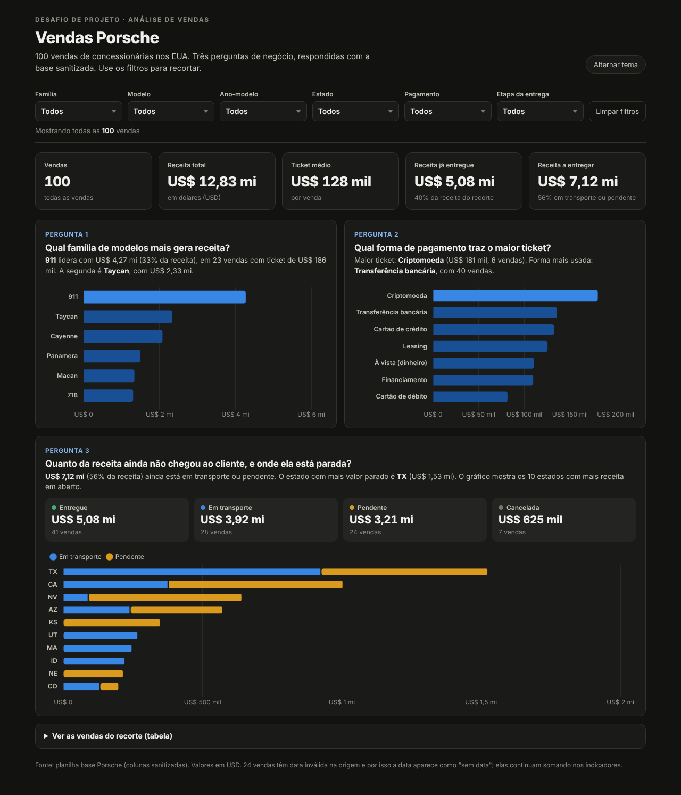
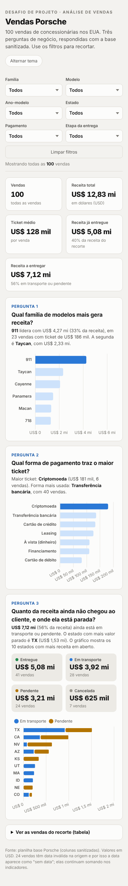

# Dashboard de Vendas Porsche

Dashboard interativa, em um único arquivo HTML, que transforma uma planilha de 100 vendas da Porsche em respostas para três perguntas de negócio.

**Dashboard publicada:** https://kepperibeiro-bot.github.io/dashboard_porshe_entrega_dio/



## As perguntas de negócio

| # | Pergunta | Por que escolhi | Como a dashboard responde |
|---|----------|-----------------|---------------------------|
| 1 | **Qual família de modelos mais gera receita?** | A base tem mais de 40 versões diferentes, o que fragmenta a leitura. Agrupando por família (911, Cayenne, Macan, Panamera, Taycan, 718), fica claro onde está o dinheiro e o mix de produto que sustenta a operação. | Barras horizontais de receita por família, com a líder destacada. O tooltip mostra quantidade de vendas e ticket médio. |
| 2 | **Qual forma de pagamento traz o maior ticket?** | Saber se o cliente que financia compra carros mais baratos (ou mais caros) do que quem paga à vista ajuda a decidir em quais condições comerciais investir. | Barras com o ticket médio por forma de pagamento. O texto acima do gráfico compara o maior ticket com a forma mais usada. |
| 3 | **Quanto da receita ainda não chegou ao cliente, e onde ela está parada?** | Venda registrada não é venda concluída. Receita pendente ou em transporte é risco de cancelamento e pede acompanhamento. | Quatro cartões com a receita por etapa (Entregue, Em transporte, Pendente, Cancelada) e um gráfico empilhado com os 10 estados que concentram mais receita em aberto. |

**Indicadores de topo:** número de vendas, receita total, ticket médio (comparado à média geral quando há filtro), receita já entregue e receita a entregar.

**Filtros:** família, modelo, ano-modelo, estado, forma de pagamento e etapa da entrega. Os filtros funcionam em cascata (ao escolher a família 911, o filtro de modelo mostra só as versões do 911) e há um botão para limpar tudo.

### Exemplo de filtro aplicado

Família **911** + pagamento **Transferência bancária**: 8 vendas, ticket médio de US$ 221 mil (bem acima da média geral de US$ 128 mil) e 81% da receita ainda em transporte ou pendente.



A dashboard também tem tema escuro e se adapta ao celular:

| Tema escuro | Celular |
|---|---|
|  |  |

## Tratamento da base antes da IA

O script [`scripts/tratar_base.py`](scripts/tratar_base.py) faz todo o tratamento e gera [`data/vendas_porsche_tratada.csv`](data/vendas_porsche_tratada.csv).

1. **Só colunas sanitizadas.** Das 21 colunas, ficaram 10: id, data, modelo, ano-modelo, preço, quilometragem, pagamento, cidade, estado e status de entrega.
2. **Dados pessoais fora.** `customer_name` e `salesperson` foram removidos, porque a base vai embutida no HTML público.
3. **Tipos numéricos.** Preço, ano-modelo e quilometragem convertidos de texto para número.
4. **Datas inválidas.** 24 vendas têm `INVALID` na data sanitizada. Elas viram data vazia, mas continuam contando nos indicadores (o preço delas é válido). Também notei 20 vendas com data posterior a outubro de 2026, o que sugere erro na origem; como a dashboard não usa a data em nenhum gráfico, mantive e registrei aqui.
5. **Colunas derivadas para os filtros:**
   - `familia`: primeira palavra do modelo (ex.: "911 Turbo S" vira "911").
   - `etapa_entrega`: os 10 status originais agrupados em 4 etapas (Entregue; Em transporte = In Transit, Shipped, Awaiting Delivery, Awaiting Pickup; Pendente = Pending, Pending Approval, Pending Review, Awaiting Review; Cancelada).
   - `forma_pagamento`: tradução para português, juntando Wire Transfer, Bank Transfer e ACH Payment em "Transferência bancária".

Para regerar a dashboard com uma base nova:

```bash
python scripts/tratar_base.py caminho/da/base.xlsx
python scripts/build.py
```

O `build.py` injeta `data/vendas.json` no modelo `scripts/template.html` e gera o `index.html`.

## Ferramenta usada e prompt

Usei o **Claude** (Anthropic) como agente, com uma skill própria de visualização de dados (regras de forma do gráfico, paleta validada para daltonismo, tooltips e modo escuro). Não usei o ChatGPT com Canvas nesta entrega.

### Prompt inicial

> Preciso entregar o desafio da dashboard de vendas Porsche. Segue o enunciado e a planilha base. Monte uma dashboard em HTML, arquivo único, com três perguntas de negócio, cada uma respondida por um gráfico ou indicador; filtros de família, modelo, ano-modelo, estado, pagamento e etapa da entrega; indicadores de topo (vendas, receita, ticket médio); visual coerente. Use só as colunas sanitizadas, converta preço e ano para número e não inclua dados pessoais. Também preciso do README explicando as perguntas, o prompt, o tratamento da base e a ferramenta usada.

### O que mudou até a versão final

| Versão | Pedido / ajuste | Motivo |
|---|---|---|
| v1 | Dashboard com as 3 perguntas, 5 KPIs, 6 filtros e tabela de detalhe | Primeira entrega a partir do prompt |
| v2 | Limitar a espessura das barras | Com filtro que deixa uma única categoria, a barra ocupava o card inteiro |
| v3 | Desligar a animação dos gráficos | Ao alternar para o tema escuro, os gráficos eram recriados no meio da animação e apareciam vazios |
| v4 | Reduzir o tamanho dos números dos KPIs no celular | Os valores quebravam em duas linhas em telas de 390 px |
<!-- Acrescente aqui os ajustes que você fizer depois -->

## Visual

- **Tipografia:** Manrope (Google Fonts).
- **Paleta:** fundo off-white e grafite, com azul como cor única de destaque. Em cada gráfico, só a categoria líder fica em azul forte e as demais em azul claro, para o olho ir direto à resposta. As etapas de entrega usam verde (entregue), azul (em transporte), âmbar (pendente) e cinza (cancelada).
- **Tema escuro** automático pelo sistema, com botão para alternar.

## Estrutura do repositório

```
dashboard_porshe_entrega_dio/
├── index.html                      # a dashboard (arquivo único, dados embutidos)
├── README.md
├── data/
│   ├── vendas_porsche_tratada.csv  # base tratada
│   └── vendas.json                 # mesma base em JSON, usada no build
├── scripts/
│   ├── tratar_base.py              # tratamento da planilha
│   ├── template.html               # modelo da dashboard
│   └── build.py                    # gera o index.html
└── img/                            # prints usados neste README
```

## Como publicar

1. Crie um repositório público chamado `dashboard_porshe_entrega_dio` na sua conta do GitHub.
2. Envie todos os arquivos desta pasta.
3. Em **Settings > Pages**, escolha a branch `main` e a pasta `/ (root)`.
4. Em um ou dois minutos a dashboard fica no ar em `https://kepperibeiro-bot.github.io/dashboard_porshe_entrega_dio/`.

Tecnologias: HTML, CSS e JavaScript puro, com [Chart.js 4.4.1](https://www.chartjs.org/) via CDN. Python e pandas no tratamento da base.
